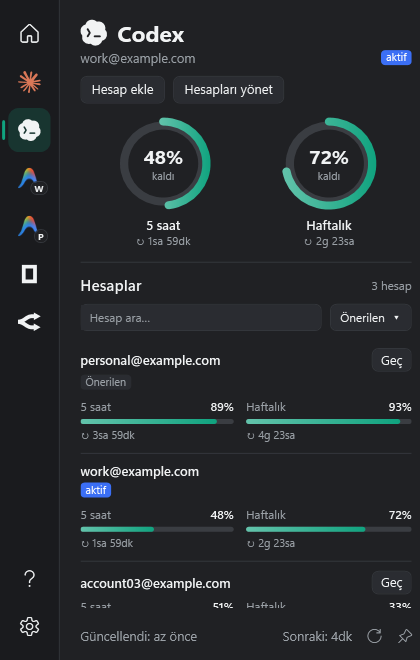
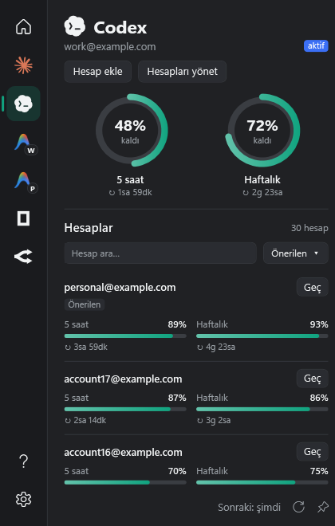

# Codex account integration

Quota Bar keeps valuex's native WPF panel, colors, taskbar gauges and provider screens. Codex login, credentials, usage, reset credits and account handoff are provided by **liuzhao1225/codex-account-switcher v0.1.27**, not a new account implementation. See [source provenance](../vendor/CodexAccountSwitcher/UPSTREAM.md).

## One page for many accounts

The sidebar has one Codex entry, regardless of the number of accounts. The page keeps the original 420 × 660 panel size and uses the existing provider icon, typography, active badge, circular gauges, usage bars and section separators. Active-account rings sit above a compact scrolling list. Each row shows identity, remaining 5-hour and weekly quotas, reset countdowns and a Switch action. Reset-credit counts appear in the row tooltip. The active account is marked in the header and its row.

Search and sorting stay above the scrolling list; the existing panel refresh button refreshes the account engine. Sort by recommendation, weekly remaining, 5-hour remaining or the next 5-hour reset. The recommendation maximizes the lower of the two remaining percentages; exhausted, stale and incomplete readings cannot become recommendations. Readings older than 15 minutes are excluded from recommendations. Recommendation is informational and never switches accounts automatically.





Account management expands on the same page: add via browser, register current login, remove inactive accounts and opt into upstream's reset-before-expiry feature. Switching and removing have in-panel confirmations. Desktop switch confirmation explains interrupted tasks and possible loss of unsaved work. The overview also has one Codex card; the taskbar's `codex|primary` and `codex|secondary` aliases follow the active account.

## Original engine and state

- Quota Bar starts the bundled `SwitcherHost.exe` and uses upstream's native C# stdio transport and Windows Desktop adapters.
- Swift `AccountController`, `AccountStore`, `CodexClient` and `SwitchService` own account policy. The UI receives presentation snapshots, not tokens.
- Browser login uses Codex app-server `account/login/start` and its completion notification in a separate account home. It leaves the active login unchanged.
- All profiles are refreshed through their own app-server homes. A failed read retains that profile's last successful usage with an explicit stale state.
- Confirmed switch follows upstream: preflight, close Desktop, verify/save current credential, activate target, verify local target identity, commit selection, reopen Desktop. Target verification or registry-commit failure restores the saved original. Reopen failure keeps the selected account active and reports the failure.
- Windows matches Store identity or the full executable path, including `ChatGPT.exe`, and terminates only Desktop and its descendants. Independent terminal sessions survive.
- Quota Bar's previous direct HTTP/token-refresh implementation is removed. `qb codex` and MCP consume the desktop app's last snapshot; they do not open a competing account engine or refresh tokens.

## Existing accounts

The integration reuses `%LOCALAPPDATA%\Codex Account Switcher`, or `CODEX_SWITCHER_DATA_HOME`, so existing Switcher accounts remain available without export/import. Close the standalone Switcher before running this copy. It uses the same named instance mutex, preventing concurrent ownership of that store. The active home follows `CODEX_HOME`, otherwise `%USERPROFILE%\.codex`.

Saved credentials use upstream's ordinary `auth.json` files with user-only ACLs. No extra encrypted vault or password prompt is introduced.

## Build and run

```powershell
./tools/prepare-switcher-runtime.ps1
dotnet test tests/QuotaBar.Tests
dotnet run --project tests/QuotaBar.SwitcherChecks -- artifacts/switcher-runtime/SwitcherHost.exe
dotnet run --project tests/QuotaBar.UiChecks -- artifacts/screenshots
dotnet run --project src/QuotaBar.App -- --demo --lang=tr --page=codex-accounts
```

The bootstrap verifies the official v0.1.27 EXE SHA-256, runs its isolated `--self-test`, verifies the extracted host hash and stages its runtime DLLs/licenses under `artifacts/switcher-runtime`. App builds and publish copy this folder. No Swift SDK is required to use the prepared application. An explicitly supplied `-RuntimeDirectory` can instead provide a locally built host with its runtime and licenses. Vendored Swift sources permit rebuilding the original Windows core with Swift 6.2+ and Windows C++ SDK tooling.

For real use, quit the installed Quota Bar first, because both versions share its existing single-instance identity. Then open the prepared `QuotaBar.exe` and select Codex in the sidebar. The existing installation is not replaced by building or publishing to `artifacts`.

## Validation boundary

Unit tests check quota mapping, stable account IDs and ranking. Integration checks execute the actual released Swift host against disposable fake credentials and a fake app-server: browser flow, active/inactive quota, cache failure, restoration, ordered handoff, removal protection, cancellation, mutex ownership and restart persistence. Native upstream Desktop tests use synthetic Windows processes; they do not terminate the user's Desktop. UI checks render thirty fictional accounts and exercise one sidebar entry, search, management and confirmations without starting the engine.

These checks do not prove live browser authentication, a real-account Desktop handoff, or actual reset-credit consumption. The Swift source test suite has not been executed on this machine because Swift tooling is not installed. Source tests are retained in the vendor snapshot; the released host's original self-test and the native/integration checks do run locally.
